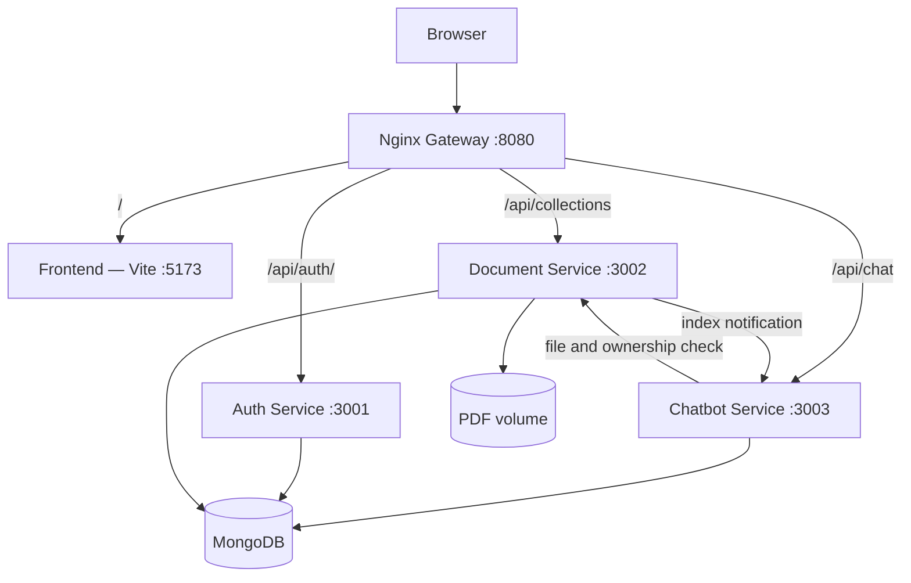

# DocMind

**Organize your documents. Ask questions. Find answers with context.**
# DocMind

**Organize your documents. Ask questions. Find answers with context.**

DocMind is a full-stack application being built to help users organize documents into collections and ask questions about their contents using Retrieval-Augmented Generation (RAG).

The authentication system, collections API, and containerized development environment are implemented. Users can manage PDFs in each collection. Users can ask questions about indexed PDFs and see the supporting filenames and page numbers.

## Features

### Implemented

- Collection creation, listing, editing, and deletion with per-user ownership checks.
- Per-collection PDF uploads, authenticated downloads, and deletion.
- User registration and login.
- Password hashing with bcrypt.
- JWT access tokens and rotating refresh tokens.
- Refresh tokens stored in HttpOnly cookies.
- Session restoration after page reload.
- Protected frontend routes, including the collections dashboard at `/collections`.
- Cross-tab authentication synchronization.
- Responsive authentication interfaces built with Material UI.
- Docker Compose development environment.
- Nginx gateway for frontend and API routing.

## Tech Stack

| Layer | Technologies |
|---|---|
| Frontend | React, TypeScript, Material UI, Vite |
| Backend | Node.js, TypeScript, Express |
| Database | MongoDB, Mongoose |
| Validation | Zod |
| Authentication | JWT, bcrypt, rotating refresh tokens |
| Infrastructure | Docker, Docker Compose, Nginx |
| Chatbot service | Python, FastAPI, pypdf, PyMongo, Gemini |

## Architecture



Nginx is the application's entry point:

- Frontend requests are forwarded to Vite.
- Authentication requests are forwarded to the auth service.
- Collection requests are forwarded to document-service. Both APIs connect to separate databases on the internal MongoDB server.

React runs in the browser. The frontend container runs Vite, which serves the frontend files.

> The current setup uses Vite's development server with hot updates and is intended for local development.

## Project Structure

```text
DocMind/
├── auth-service/         # Authentication API
├── document-service/     # Collections and PDF API
├── chatbot-service/      # PDF indexing and collection chat
├── frontend/             # React application
├── nginx/                # Gateway configuration
└── README.md
```

The Docker Compose configuration is located at the repository root.

## Getting Started

### Prerequisites

- Docker and Docker Compose.
- Git.
- Node.js and npm if running the frontend outside Docker.

### 1. Clone the repository

Clone this repository and open its root directory.

### 2. Configure environment variables

On first setup, copy `auth-service/.env.example` to `auth-service/.env` and set
`JWT_ACCESS_SECRET` to a random secret (for example, generate one with
`openssl rand -hex 32`). If auth already works, keep its existing secret.
Compose reads that file for both APIs so document-service can verify access
tokens issued by auth-service. Keep the populated file local.

| Variable | Auth service in Compose | Document service in Compose |
|---|---|---|
| `PORT` | `3001` | `3002` (internal) |
| `MONGO_URI` | `mongodb://mongodb:27017/docmind_auth` | `mongodb://mongodb:27017/docmind_documents` |
| `JWT_ACCESS_SECRET` | Signing key from `auth-service/.env` | Same key, for HS256 verification |
| `NODE_ENV` | From the env file | From the env file |

Compose sets each service's port and database URI. To run document-service directly, copy
`document-service/.env.example` to `document-service/.env`, set the same signing key and
provide a running local MongoDB. From `document-service/`, run `npm ci` and `npm run dev`.

### 3. Build and start the services

```bash
docker compose up -d --build
```

Open the application:

**http://localhost:8080**

### Available Addresses

| Address | Purpose |
|---|---|
| `http://localhost:8080` | Application entry point |
| `http://localhost:8080/collections` | Default signed-in dashboard with collection management, theme selection, and account actions |
| `http://localhost:8080/login` | Login page |
| `http://localhost:8080/register` | Registration page |
| `http://localhost:8080/health` | Authentication service health |
| `http://localhost:8080/health/documents` | Document service health (direct service route is `/health`) |
| `127.0.0.1:27017` | MongoDB access from the host |

## Frontend Development

The frontend container runs Vite on port `5173`.

Source folders are mounted into the container:

```yaml
volumes:
  - ./frontend/src:/app/src
  - ./frontend/public:/app/public
```

Changes to these folders are available inside the container immediately. Vite updates the browser through its WebSocket connection, proxied by Nginx.

Changes to dependencies or configuration outside the mounted folders require rebuilding:

```bash
docker compose up -d --build frontend
```

Frontend API calls use relative URLs, such as:

```text
/api/auth/login
```

This sends requests through the same Nginx gateway used to load the application.

## Authentication

The authentication flow uses:

- Short-lived JWT access tokens stored in frontend memory.
- Refresh tokens stored in HttpOnly cookies.
- Hashed refresh-token values stored in MongoDB.
- Refresh-token rotation.
- Expiration checks and a MongoDB TTL index for expired records.
- Cross-tab notifications and coordination for authentication changes.

The frontend restores sessions after reload and prevents a refresh from silently switching an authenticated tab to another account.

Logout deletes the refresh session and clears frontend authentication state. Already-issued access tokens may remain valid until expiry unless the backend separately enforces revocation.

### API Endpoints

| Method | Endpoint | Description |
|---|---|---|
| `POST` | `/api/auth/register` | Create an account |
| `POST` | `/api/auth/login` | Authenticate a user |
| `POST` | `/api/auth/refresh` | Refresh the access token and rotate the refresh token |
| `POST` | `/api/auth/logout` | End the refresh session |
| `GET` | `/api/auth/me` | Retrieve the authenticated user |
| `GET` | `/health` | Check service availability |

Refer to the route handlers and validation schemas for request fields and response formats.

## Collections and PDF API

Use the gateway at `http://localhost:8080`. Every request to `/api/collections`
requires `Authorization: Bearer <access token>`. Send JSON bodies with
`Content-Type: application/json`. The service verifies the token and uses its
`sub` as the owner. The only writable fields are `name` and `description`.

| Method and path | Request | Success |
|---|---|---|
| `POST /api/collections` | Required `name`, optional `description` | `201` with `{ "collection": ... }` |
| `GET /api/collections?page=1&limit=20` | Optional positive decimal integers | `200` with `{ "collections": [...], "page": 1, "limit": 20, "hasMore": false }` |
| `GET /api/collections/:id` | 24-character hexadecimal collection ID | `200` with `{ "collection": ... }` |
| `PATCH /api/collections/:id` | At least one writable field | `200` with the updated `{ "collection": ... }` |
| `DELETE /api/collections/:id` | Collection ID | `204` with an empty body |

Names are trimmed and must contain 1–100 characters after trimming. Descriptions
are strings up to 500 characters. Omit the description on creation to leave it
absent, or send an empty string to clear its text on update. Omitted fields on
PATCH retain their values. Listing returns only the caller's collections, ordered
by creation time descending, then ID descending for ties. Page defaults to 1
(maximum 10,000) and limit defaults to 20 (maximum 100). An empty page returns
`collections: []` and `hasMore: false`. New insertions can shift page boundaries.

Example collection response:

```json
{
  "collection": {
    "id": "67a123456789abcdef000002",
    "name": "Research",
    "description": "Reading notes",
    "ownerId": "67a123456789abcdef000001",
    "createdAt": "2026-11-20T10:00:00.000Z",
    "updatedAt": "2026-11-20T10:00:00.000Z"
  }
}
```

Invalid fields (including a supplied `ownerId`), IDs, or query parameters return
`400` with `errors.formErrors` and `errors.fieldErrors`. Malformed JSON returns
`400 INVALID_JSON`. Missing, invalid, or expired access tokens return `401` with
`{ "code": "...", "message": "..." }`, using auth-service's `UNAUTHORIZED`,
`INVALID_TOKEN`, and `TOKEN_EXPIRED` codes. A missing or unowned collection
returns the same `404 COLLECTION_NOT_FOUND` response. Refresh through the
existing auth API when the access token expires.

### Try it in Postman

1. Start the stack with `docker compose up -d --build`. Set a Postman environment variable `baseUrl` to `http://localhost:8080`.
2. For a new user, POST `{{baseUrl}}/api/auth/register` with raw JSON `{"name":"Test User","email":"test@example.com","password":"example-password"}`. POST the email and password to `{{baseUrl}}/api/auth/login`. Copy the login response's `accesstoken` value to a local Postman variable named `accessToken`. The refresh endpoint spells the response field `accessToken`.
3. Set Authorization to **Bearer Token** with value `{{accessToken}}`. POST `{{baseUrl}}/api/collections` with raw JSON `{"name":"Research","description":"Reading notes"}`. Save the returned `collection.id` as `collectionId`.
4. GET `{{baseUrl}}/api/collections?page=1&limit=10`, then GET `{{baseUrl}}/api/collections/{{collectionId}}`. PATCH the same item URL with `{"name":"Archived research"}`.
5. DELETE the item URL and expect `204`. GET it again and expect `404`. To check ownership, use a second user's token on an existing first-user collection and expect the same `404`.

### Verify the collections backend

From `document-service/`, run `npm ci`, `npm test`, `npm run typecheck`, and
`npm run build`. The tests use Supertest and start their own MongoDB process.
The first run needs access to a MongoDB binary. From the repository root,
`node auth-service/tests/gateway-smoke.mjs` exercises auth and collections
through Nginx on a disposable Docker network with a test database.

## PDFs in a collection

Open a collection card at [Collections](http://localhost:8080/collections) and choose **Upload PDF**. Its page at `/collections/:id` shows filenames, upload dates, and actions to download or delete each file. Deleting the collection also deletes its PDFs.

All four endpoints require the same bearer access token used by collection CRUD. The base path is `/api/collections/:collectionId/documents`.

| Method and path relative to the base | Request | Success |
|---|---|---|
| POST `/` | Multipart form data with one File field named `file` | `201` with `{ "document": ... }` |
| GET `/` | No body | `200` with `{ "documents": [...] }`, newest first |
| GET `/:documentId/download` | No body | `200 application/pdf` attachment with the original filename |
| DELETE `/:documentId` | No body | `204` |

Each document contains `id`, `collectionId`, `originalFilename`, `size` in bytes, `contentType`, and an ISO `uploadedAt` timestamp. Missing or inaccessible collections return `404 COLLECTION_NOT_FOUND`. A document outside the specified owned collection returns `404 DOCUMENT_NOT_FOUND`.

Uploads must declare `application/pdf`, start with a PDF version header, end with the PDF EOF marker, and be **10 MiB or smaller**. The service returns `400` for invalid files or multipart fields and `413` for oversized uploads. Nginx accepts up to 11 MiB for the whole request to allow room for multipart headers. In Postman select **Body → form-data**, choose **File** for the `file` field, and let Postman set the multipart boundary.

### Storage and recovery

MongoDB holds metadata in `docmind_documents`. The document service writes bytes under generated keys to `PDF_STORAGE_DIR` (default `./data/pdfs` outside Docker). Compose mounts the named `document_pdfs` volume at `/data/pdfs`. Back up the database and volume together. An ordinary container restart or replacement preserves both.

The Compose setup runs one document-service instance. It serializes file mutations per collection and rechecks ownership after receiving an upload. It records an upload before writing any bytes and publishes it after the write succeeds. For deletion it marks the document or collection first, then removes the files before their metadata. An I/O or database failure returns an error and leaves any unfinished work recorded. Before serving traffic on startup, the service discards incomplete uploads and finishes pending deletions. Retrying a deletion also finishes its pending cleanup. Ready documents in other collections remain available.

Run `npm --prefix document-service test` for ownership, validation, and storage recovery coverage. Run `make test-e2e` for the browser workflow through Nginx, including a byte-for-byte download after replacing the isolated document-service container.

## Collection chat

From the repository root, run `cp -n chatbot-service/.env.example chatbot-service/.env`. Edit **`chatbot-service/.env`** and set `GEMINI_API_KEY` locally. Only the chatbot container receives this file. It is excluded from Git and the Docker build context.

`GEMINI_GENERATION_MODEL` in the same file selects the answer model and defaults to `gemini-3.5-flash-lite`. After changing it, run `docker compose up -d --no-deps --force-recreate chatbot-service`. Existing PDF embeddings can be reused.

```sh
docker compose up -d --build
docker compose exec nginx nginx -s reload
```

Open [Collections](http://localhost:8080/collections), sign in, open a collection and upload [field-guide.pdf](chatbot-service/tests/field-guide.pdf). When its status reaches **ready**, ask **What is the project code name?** The expected answer is **Juniper**, citing **field-guide.pdf · page 2**. The latest answered question and its evidence are saved with each collection. Earlier turns remain in memory during the signed-in session. Recent chats opens the latest saved conversation.

The Collections dashboard uses `GET /api/collections/dashboard?page=1&limit=9` for owner-scoped counts, indexing status, questions, and the three most recent uploads across all pages. Settings in the top navigation controls the persisted color mode.

### Chat API

Send `POST /api/chat` through Nginx with `Authorization: Bearer <access token>`, `Content-Type: application/json`, and a question of 1–2000 characters. The collection page sends the checked ready PDF IDs in `documentIds`. An empty selection is invalid. Every supplied ID must belong to a ready document in the owned collection. Omitting the field retains collection-wide search. Example request and response:

```json
{"collectionId":"67a123456789abcdef000002","question":"What is the project code name?"}
```

```json
{"answer":"The project code name is Juniper.","sources":[{"documentId":"67a123456789abcdef000003","filename":"field-guide.pdf","page":2}]}
```

Chat checks ownership through document-service before retrieval. A missing or unowned collection returns `404`, an invalid session returns `401`, and a collection without ready PDFs returns `409 NO_READY_PDFS`. If retrieved passages do not support an answer, the response explains that with an empty sources array.

### Index lifecycle

Upload returns `201` as soon as the original PDF is saved. The document service wakes the worker over the internal Compose network. The worker also polls MongoDB for missed notifications, expired claims and previously uploaded PDFs. The list and upload responses include `indexStatus` (`pending`, `indexing`, `ready` or `failed`) and an optional `indexError`. Failed PDFs can still be downloaded. Use **Retry indexing** after fixing a key or quota issue. For a scanned PDF, upload a copy with selectable text. An owner can request a rebuild with `POST /api/collections/:id/documents/:documentId/index` (empty body, `202`).

The original bytes stay in document-service. Chatbot-service reads a PDF for its current job, splits its selectable text per page, and sends passage text with the filename to Gemini for embedding. It stores 768-dimensional embeddings and one-based page numbers with the document's collection ID, document ID, and filename in MongoDB. The worker publishes all passages in one conditional update, so a retry replaces the previous index and a late job cannot recreate a deleted PDF. The MVP supports up to 1,500 pages and 1,200 passages per PDF to keep the index within MongoDB's document limit.

Queries use [gemini-embedding-2](https://ai.google.dev/gemini-api/docs/embeddings) and cosine similarity across the selected ready documents in the owned collection. The question and up to five retrieved passages go to the configured answer model. Each source includes its stored passage in `snippet` and a verified verbatim `highlight` when available. Answer `statements` use one-based citation numbers into the returned `sources`. Open page links fetch the PDF through the authenticated download endpoint and position the viewer on that page.

### Run the chat checks

From the repository root, `make test-e2e` runs the isolated MongoDB indexing checks and the browser suite with a deterministic Gemini HTTP transport. For the live browser test, configure the key above and run:

```sh
make test-chat-live
```

This starts the isolated stack, sends the two-page fixture and test question to Gemini, checks the answer and page citation through Nginx, and removes the test containers and test PDF volume. Both targets use the project's existing Playwright installation in `frontend`.

## Useful Commands

Start and rebuild services:

```bash
docker compose up -d --build
```

View running containers:

```bash
docker compose ps
```

Follow logs:

```bash
docker compose logs -f frontend nginx auth-service
```

Reload Nginx after configuration changes:

```bash
docker compose restart nginx
```

Stop services while keeping persistent database data:

```bash
docker compose down
```

## Roadmap

- [x] Authentication API.
- [x] React authentication interface.
- [x] Session restoration and protected routes.
- [x] Cross-tab authentication handling.
- [x] Containerized frontend and Nginx routing.
- [x] Collections API and gateway routing.
- [x] Collection management frontend.
- [x] Document uploads and ownership checks.
- [x] Text extraction and chunking.
- [x] Embeddings and collection-scoped retrieval.
- [x] Chatbot API.
- [x] Chat interface with source references.

## Author

**Marouane Saadaoui**

DocMind is a learning and portfolio project exploring full-stack development, authentication, microservices, Docker networking, and document-based AI applications.
