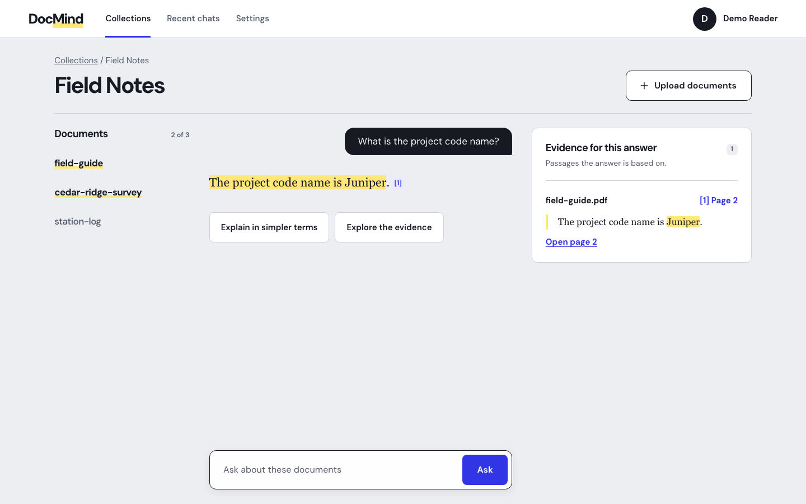

# DocMind

DocMind lets you ask questions about PDFs and check the answers against the original pages. Organize files into a collection, choose which documents to search, and follow an inline citation to its supporting passage or PDF page.



[Collections dashboard](docs/screenshots/collections.png) · [Mobile evidence panel](docs/screenshots/mobile-evidence.png) · [Login](docs/screenshots/login.png) · [Register](docs/screenshots/register.png) · [API reference](docs/api.md)

## Run locally

Install Git, Docker, and Docker Compose. From a fresh checkout, copy the two environment templates.

```sh
git clone https://github.com/mar1-hh/DocMInd.git
cd DocMInd
cp -n auth-service/.env.example auth-service/.env
cp -n chatbot-service/.env.example chatbot-service/.env
```

| File | Setting |
| --- | --- |
| `auth-service/.env` | Set `JWT_ACCESS_SECRET` to a random value. You can generate one locally with `openssl rand -hex 32`. Compose shares the signing secret with document-service so it can verify access tokens. |
| `chatbot-service/.env` | Set `GEMINI_API_KEY` for PDF indexing and chat. The generation model defaults to `gemini-3.5-flash-lite` and can be changed with `GEMINI_GENERATION_MODEL`. |

```sh
docker compose up -d --build
```

Open [DocMind on localhost](http://localhost:8080) and register. This Compose stack runs the Vite development server behind Nginx. Use `docker compose down` to stop it while keeping your database and PDFs.

After changing the Gemini key or answer model, run `docker compose up -d --no-deps --force-recreate chatbot-service`. Switching the answer model reuses the stored embeddings.

### Try a question with a known answer

1. Create a collection, open it, and choose **Upload documents**. Use the included [two-page field guide](chatbot-service/tests/field-guide.pdf).
2. Once indexing finishes, the filename appears with a yellow underline to show it is selected. Click a filename to include or exclude it. With **field-guide** selected, ask **“What is the project code name?”**
3. The expected answer is **Juniper**. Click the citation to read the passage, then choose **Open page 2** to check it in the PDF.

Each upload accepts one text-based PDF up to 10 MiB. Scanned pages need selectable text for indexing. Passage text and filenames go to Gemini for embedding. When you ask a question, Gemini receives the question and retrieved passages from the selected PDFs.

## How it works

| Component | Responsibility |
| --- | --- |
| React, TypeScript, Material UI | Collections, PDF management, chat and evidence in desktop and mobile layouts |
| Nginx | Single browser entry point for the frontend and APIs |
| Auth service · Express | Accounts, JWT access tokens, hashed rotating refresh tokens, and sign-out across tabs |
| Document service · Express, Mongoose | Collection ownership, PDF validation, file storage, downloads, and deletion |
| Chatbot service · FastAPI, pypdf | Extracts page text, generates embeddings, retrieves passages, and resolves citations against stored filenames and page numbers |
| MongoDB and Docker volumes | Persist accounts, collections, document metadata, embeddings, and original PDFs |

Indexing runs in the background. At question time, the chatbot verifies collection access and ranks passages from selected ready PDFs using cosine similarity. When the passages lack supporting evidence, the chat can report that and return an empty source list.

The [API reference](docs/api.md) covers request and response formats, Postman examples, ownership checks, and recovery after interrupted file operations.

## Testing

The end-to-end suite runs registration, login, collection management, PDF uploads, chat, and citation navigation against an isolated Docker stack. Its default Gemini transport uses deterministic responses, so it runs without an API key.

With Node.js 22 and npm installed, run from the repository root.

```sh
npm --prefix frontend ci
(cd frontend && npx playwright install chromium)
make test-e2e
```

For the same PDF-to-citation flow using the real Gemini API, configure the chatbot key and run `make test-chat-live`.

| Check | Command from the repository root |
| --- | --- |
| Frontend lint and production build | `npm --prefix frontend run lint && npm --prefix frontend run build` |
| Auth API integration tests | `npm --prefix auth-service ci && npm --prefix auth-service test` |
| Collections and PDF integration tests | `npm --prefix document-service ci && npm --prefix document-service test` |

The API tests use disposable MongoDB databases. Their first run can download a MongoDB binary. See the [auth test notes](auth-service/tests/README.md) for session and proxy coverage.

Built by **Marouane Saadaoui** as a full-stack portfolio project.
