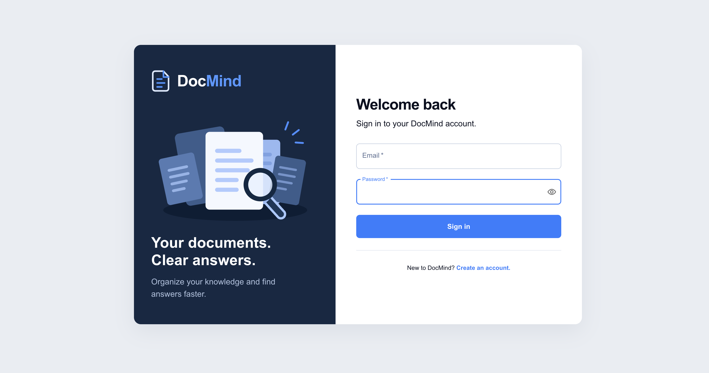
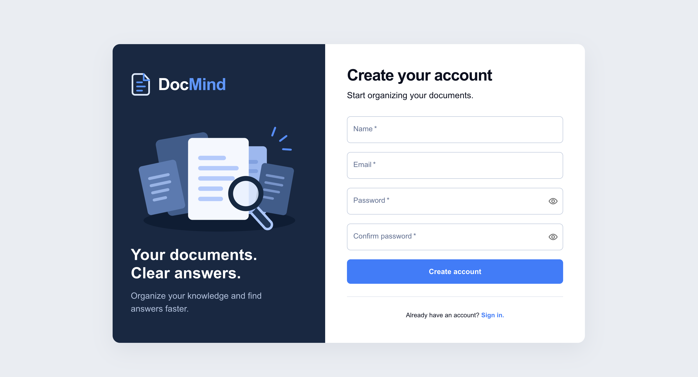
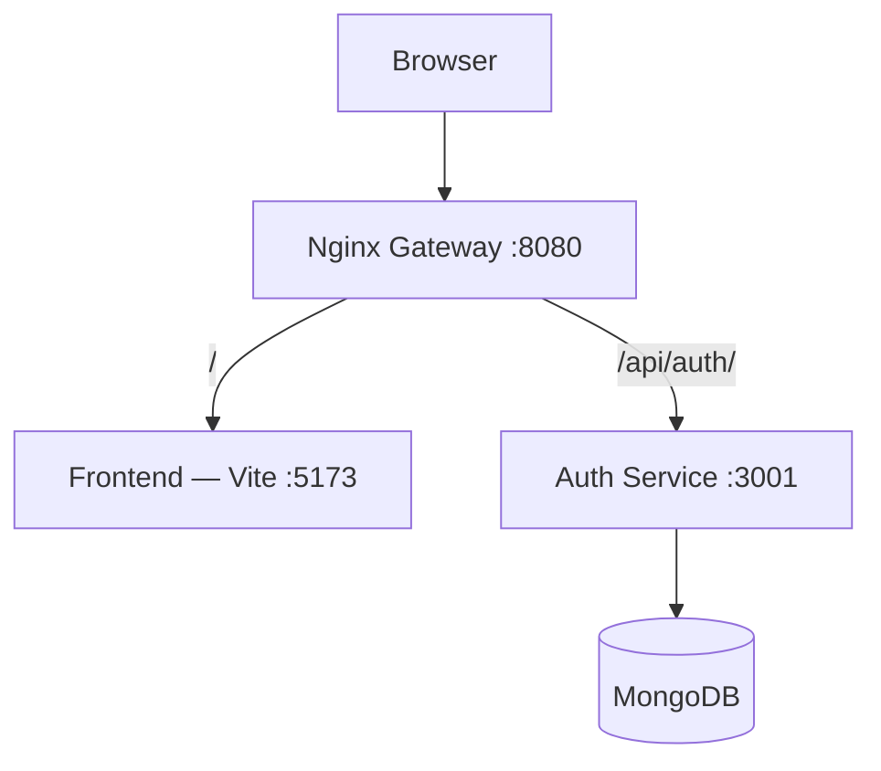

# DocMind

**Organize your documents. Ask questions. Find answers with context.**
# DocMind

**Organize your documents. Ask questions. Find answers with context.**

DocMind is a full-stack application being built to help users organize documents into collections and ask questions about their contents using Retrieval-Augmented Generation (RAG).

The authentication system and containerized development environment are implemented. Document management and the RAG chatbot are planned next.

## Features

### Implemented

- User registration and login.
- Password hashing with bcrypt.
- JWT access tokens and rotating refresh tokens.
- Refresh tokens stored in HttpOnly cookies.
- Session restoration after page reload.
- Protected frontend routes.
- Cross-tab authentication synchronization.
- Responsive authentication interfaces built with Material UI.
- Docker Compose development environment.
- Nginx gateway for frontend and API routing.

### Planned

- Create and manage document collections.
- Upload, list, and delete documents.
- Extract and split document text into chunks.
- Generate embeddings and retrieve relevant content.
- Ask questions within a selected collection.
- Display source references alongside chatbot answers.

## Tech Stack

| Layer | Technologies |
|---|---|
| Frontend | React, TypeScript, Material UI, Vite |
| Backend | Node.js, TypeScript, Express |
| Database | MongoDB, Mongoose |
| Validation | Zod |
| Authentication | JWT, bcrypt, rotating refresh tokens |
| Infrastructure | Docker, Docker Compose, Nginx |
| Planned chatbot service | Python, RAG |

## Architecture



Nginx is the application's entry point:

- Frontend requests are forwarded to Vite.
- Authentication requests are forwarded to the auth service.
- The auth service connects to MongoDB through Docker's internal network.

React runs in the browser. The frontend container runs Vite, which serves the frontend files.

> The current setup uses Vite's development server with hot updates and is intended for local development.

## Project Structure

```text
DocMind/
├── auth-service/         # Authentication API
├── frontend/             # React application
├── nginx/                # Gateway configuration
└── README.md
```

The Docker Compose configuration is located at the repository root.

Planned services:

- `document-service`: document collections, uploads, and metadata.
- `chatbot-service`: document retrieval and answer generation.

## Getting Started

### Prerequisites

- Docker and Docker Compose.
- Git.
- Node.js and npm if running the frontend outside Docker.

### 1. Clone the repository

Clone this repository and open its root directory.

### 2. Configure environment variables

Create `auth-service/.env` with the variables required by the authentication service.

If an `.env.example` file is available, use it as a template. Configure signing secrets using the exact variable names expected by the service.

Docker Compose supplies these values inside the auth container:

```env
MONGO_URI=mongodb://mongodb:27017/docmind_auth
PORT=3001
```

Do not commit actual `.env` files or secrets.

### 3. Build and start the services

```bash
docker compose up -d --build
```

Open the application:

**http://localhost:8080**

### Available Addresses

| Address | Purpose |
|---|---|
| `http://localhost:8080` | Application entry point |
| `http://localhost:8080/login` | Login page |
| `http://localhost:8080/register` | Registration page |
| `http://localhost:8080/health` | Authentication service health |
| `127.0.0.1:27017` | MongoDB access from the host |

## Frontend Development

The frontend container runs Vite on port `5173`.

Source folders are mounted into the container:

```yaml
volumes:
  - ./frontend/src:/app/src
  - ./frontend/public:/app/public
```

Changes to these folders are available inside the container immediately. Vite updates the browser through its WebSocket connection, proxied by Nginx.

Changes to dependencies or configuration outside the mounted folders require rebuilding:

```bash
docker compose up -d --build frontend
```

Frontend API calls use relative URLs, such as:

```text
/api/auth/login
```

This sends requests through the same Nginx gateway used to load the application.

## Authentication

The authentication flow uses:

- Short-lived JWT access tokens stored in frontend memory.
- Refresh tokens stored in HttpOnly cookies.
- Hashed refresh-token values stored in MongoDB.
- Refresh-token rotation.
- Expiration checks and a MongoDB TTL index for expired records.
- Cross-tab notifications and coordination for authentication changes.

The frontend restores sessions after reload and prevents a refresh from silently switching an authenticated tab to another account.

Logout deletes the refresh session and clears frontend authentication state. Already-issued access tokens may remain valid until expiry unless the backend separately enforces revocation.

### API Endpoints

| Method | Endpoint | Description |
|---|---|---|
| `POST` | `/api/auth/register` | Create an account |
| `POST` | `/api/auth/login` | Authenticate a user |
| `POST` | `/api/auth/refresh` | Refresh the access token and rotate the refresh token |
| `POST` | `/api/auth/logout` | End the refresh session |
| `GET` | `/api/auth/me` | Retrieve the authenticated user |
| `GET` | `/health` | Check service availability |

Refer to the route handlers and validation schemas for request fields and response formats.

## Useful Commands

Start and rebuild services:

```bash
docker compose up -d --build
```

View running containers:

```bash
docker compose ps
```

Follow logs:

```bash
docker compose logs -f frontend nginx auth-service
```

Reload Nginx after configuration changes:

```bash
docker compose restart nginx
```

Stop services while keeping persistent database data:

```bash
docker compose down
```

## Roadmap

- [x] Authentication API.
- [x] React authentication interface.
- [x] Session restoration and protected routes.
- [x] Cross-tab authentication handling.
- [x] Containerized frontend and Nginx routing.
- [ ] Collection management.
- [ ] Document uploads and ownership checks.
- [ ] Text extraction and chunking.
- [ ] Embeddings and collection-scoped retrieval.
- [ ] Chatbot API.
- [ ] Chat interface with source references.

## Author

**Marouane Saadaoui**

DocMind is a learning and portfolio project exploring full-stack development, authentication, microservices, Docker networking, and document-based AI applications.
